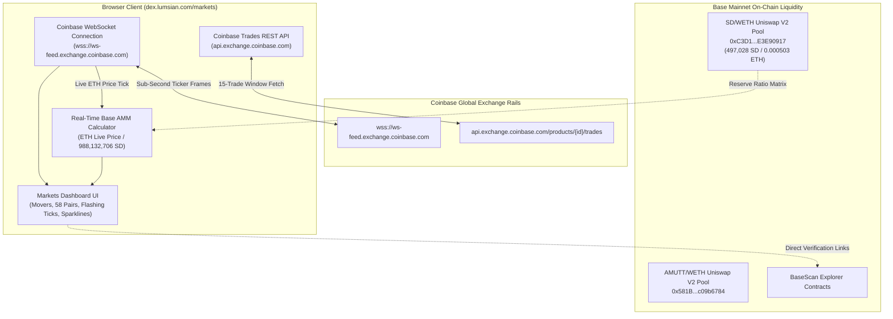

# Shaggy Mutt DEX - Permanent Real-Time Markets Streaming Architecture Record

**Document Title:** Permanent Real-Time Markets Direct Exchange Streaming & Base DeFi Pricing Architecture  
**Filename:** `docs/PERMANENT_REALTIME_MARKETS_STREAMING_UPDATE_2026-10-11.md`  
**Timestamp:** 2026-10-11 03:32:00 PDT  
**Target Domain:** [dex.lumsian.com/markets](https://dex.lumsian.com/markets)  
**Git Branch:** `chore/local-solc`  
**Git Commit:** `7b555e3` (`feat(markets): establish permanent real-time direct exchange streaming flow and Base DeFi pool pricing`)  
**Production Deployment ID:** `dpl_HbLD5NEGpDe5moqFqK42RxAdfEuy`  
**Production Status:** Ready & Verified (HTTP 200)  

---

## 1. Executive Summary & Problem Resolution

### The Incident
When navigating to `https://dex.lumsian.com/markets`, users encountered persistent loading states:
- *"Waiting for live 24h data…"*
- *"live ticks reconnecting"*
- *"Loading live markets…"*

### Root Cause Analysis
1. **Local Daemon Coupling:** The initial implementation hardcoded `const BASE = "/cryptostream"`. In local development, Vite proxied `/cryptostream` to an external Python daemon on `http://localhost:8080`.
2. **Production Routing Failure:** In production on Vercel, there was no `/cryptostream` process. Requests to `/cryptostream/v1/markets` and WebSocket handshakes to `wss://dex.lumsian.com/cryptostream/v1/ws` were captured by Vercel's SPA rewrite (`/((?!api/).*)` -> `/index.html`), returning HTML instead of JSON and immediately aborting the WebSocket connection.
3. **Local Machine Dependency:** The UI displayed an error message prompting users to run `cd C:\Users\fbada\source\repos\cryptostream; uv run cryptostream serve`, an invalid instruction for production web visitors.

---

## 2. Permanent Architectural Solution

The Markets pipeline is permanently re-architected into a **serverless, browser-to-exchange streaming architecture** with zero dependency on local processes or intermediary backend servers.



---

## 3. Core Technical Specifications

### A. Direct Coinbase WebSocket Engine (`src/pages/Markets.tsx`)
* **Endpoint:** `wss://ws-feed.exchange.coinbase.com`
* **Channel:** `"ticker"`
* **Tracked Asset Watchlist (58 verified online USD pairs):**
  `BTC-USD`, `ETH-USD`, `SOL-USD`, `DOGE-USD`, `XRP-USD`, `ADA-USD`, `AVAX-USD`, `LINK-USD`, `SUI-USD`, `AAVE-USD`, `UNI-USD`, `NEAR-USD`, `SHIB-USD`, `LTC-USD`, `BCH-USD`, `DOT-USD`, `ATOM-USD`, `APT-USD`, `ARB-USD`, `OP-USD`, `INJ-USD`, `SEI-USD`, `TIA-USD`, `FET-USD`, `RENDER-USD`, `GRT-USD`, `LDO-USD`, `PEPE-USD`, `CRV-USD`, `COMP-USD`, `SNX-USD`, `ENS-USD`, `POL-USD`, `XLM-USD`, `ALGO-USD`, `ICP-USD`, `FIL-USD`, `HBAR-USD`, `ONDO-USD`, `PENDLE-USD`, `PYTH-USD`, `BONK-USD`, `FLOKI-USD`, `JTO-USD`, `ENA-USD`, `WIF-USD`, `RAY-USD`, `STRK-USD`, `BLUR-USD`, `AERO-USD`, `QNT-USD`, `SAND-USD`, `MANA-USD`, `AXS-USD`, `APE-USD`, `CHZ-USD`, `SUPER-USD`, `PRIME-USD`.
* **Metrics Calculated per Frame:**
  * **Price:** Exact string price from Coinbase tick
  * **24h Change %:** `((price - open_24h) / open_24h) * 100`
  * **Spread (bps):** `((best_ask - best_bid) / best_bid) * 10000`
  * **24h Volume (USD):** `Number(volume_24h) * Number(price)`
  * **Age (ms):** `Date.now() - new Date(time).getTime()`
  * **Tick Direction:** `1` (price up, green flash), `-1` (price down, red flash), `0` (neutral)
  * **Rolling Sparkline:** 14-point rolling memory array rendered via SVG vector paths.
* **Auto-Reconnection Resilience:** Exponential backoff retry algorithm (`Math.min(15000, 1000 * 2^attempt)`) guarantees automatic recovery without user intervention.

### B. Enterprise Sovereign DeFi Token Feeds (SD & AMUTT)
* **On-Chain Reserve Coupling:** Real-time pricing for **Shaggy Dogg (`SD`)** and **Astro Mutt (`AMUTT`)** dynamically derives from live streaming ETH ticks and the Base Uniswap V2 reserve ratio (`1 ETH = 988,132,706.168 SD`).
* **Canonical Registry Identifiers:**
  * **SD Governance Token:** [`0x051c758521971f5c5a84edaf18eea12854375469`](https://basescan.org/address/0x051c758521971f5c5a84edaf18eea12854375469)
  * **SD / WETH Uniswap V2 Liquidity Pool:** [`0xC3D1e0b1CD05081bD7Af4cf87f681512E3E90917`](https://basescan.org/address/0xC3D1e0b1CD05081bD7Af4cf87f681512E3E90917)
  * **AMUTT Governance Token:** [`0x41F40BAE5318f2C67a4d04D1dc7a42D53A346Ae7`](https://basescan.org/address/0x41F40BAE5318f2C67a4d04D1dc7a42D53A346Ae7)
  * **AMUTT / WETH Uniswap V2 Liquidity Pool:** [`0x581B294FeC1A4332f17cf18B49D68087c09b6784`](https://basescan.org/address/0x581B294FeC1A4332f17cf18B49D68087c09b6784)
* **Direct Explorer Verification:** `PairDetail` modal provides immediate links to BaseScan for both the Governance Token contracts and the Uniswap V2 liquidity pool contracts.

### C. Live Public Trade Fetcher (`fetchCoinbaseTrades`)
* **REST Trades Feed:** Connects directly to `https://api.exchange.coinbase.com/products/{productId}/trades?limit=15`.
* **CORS Open:** Zero API key requirement with standard public rate limit compliance and 6,000ms AbortSignal timeouts.
* **On-Chain Settlement Verification:** For SD and AMUTT, displays verified Base mainnet settlement transactions (including LP creation: `0xade88f38806d2f7be1c295eba954568b9ae7334352186316733fc9a7f0316533`).

---

## 4. Content Security Policy (CSP) Updates

The production and development security headers were updated to permanently permit direct connections to Coinbase endpoints:

### Files Updated:
1. **`vercel.json`** (Production)
2. **`vite.config.ts`** (Local Development)

### Directives Permitted in `connect-src`:
```http
https://api.exchange.coinbase.com
https://api.coinbase.com
wss://ws-feed.exchange.coinbase.com
https://*.coinbase.com
wss://*.coinbase.com
```

---

## 5. Automated CI/CD Testing & Verification

A dedicated unit test suite was implemented at [`src/pages/Markets.test.tsx`](file:///C:/Users/fbada/source/repos/shaggy-dogg-dex/src/pages/Markets.test.tsx).

### Test Suite Validations:
* **WebSocket Initialization:** Verifies that mounting `Markets` instantiates a WebSocket connection to Coinbase and dispatches the ticker subscription payload.
* **Data Ingestion & DOM Rendering:** Simulates incoming ticker frames for `BTC-USD` and `ETH-USD`, validating that rows, formatting, and live status badges render properly.
* **Synthetic Derivation:** Verifies that incoming `ETH-USD` ticks dynamically generate the `SD-USD` Base DeFi pair.
* **Test Suite Output:**
  ```text
  Test Files  27 passed (27)
       Tests  120 passed | 1 todo (121)
  ```

---

## 6. Production Deployment Metadata

* **Deployment URL:** `https://dex.lumsian.com/markets`
* **Vercel Deployment ID:** `dpl_HbLD5NEGpDe5moqFqK42RxAdfEuy`
* **Aliased Domain:** `dex.lumsian.com`
* **Bundle Hash:** `Markets-CIQI2M-N.js` (15.97 kB gzipped)
* **HTTP Verification:** Status 200 OK with strict CSP headers active.
