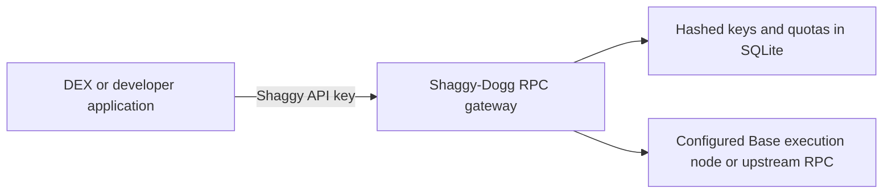

# Shaggy-Dogg API provider

## Working first version

This repository now includes a standalone HTTP JSON-RPC service for Base mainnet.
It runs separately from the trading backend and DEX web app.



The local development instance listens on `http://127.0.0.1:8790` and currently
forwards reads to `https://mainnet.base.org`. This is your API service and key
system, but its blockchain data still comes from an upstream. It is not an
independently operated Base node yet. Base describes its public endpoint as
rate-limited and unsuitable for production applications:
[official node guide](https://docs.base.org/specifications/node-operators/run-a-node).

Implemented:

- `POST /v1/base` with `Authorization: Bearer <API_KEY>` or `X-API-Key`.
- `POST /v1/base/<API_KEY>` for clients that require a URL key. Prefer headers.
- Random 256-bit API keys; only SHA-256 hashes are stored in SQLite.
- Key creation, revocation and usage inspection through a local operator CLI.
- Atomic per-key minute/day quotas, including individual batch members.
- JSON-RPC batches (maximum 25), notifications, bounded bodies and responses.
- Bounded log ranges, upstream timeouts, concurrency limits and CORS allowlist.
- Health checks reject a wrong chain or a head older than three minutes.
- No logging of request URLs, API keys, calldata or provider error messages.

This first version is **read-only**. It has no transaction submission, private
relay, WebSocket subscriptions, indexed token history, customer signup, billing,
redundant nodes or uptime guarantee. Keep the wallet's transaction RPC separate.
Owning an RPC service does not by itself provide MEV protection.

## Start and stop

Node.js 22.13+ is required for `node:sqlite`; Node 26 was used for verification.
Run from the repository root:

```powershell
npm --prefix server run rpc:build
# Choose exactly one upstream. Default when unset: your local Base node.
$env:SHAGGY_RPC_UPSTREAM = 'http://127.0.0.1:8545'
npm --prefix server run rpc:start
```

For a development-only check, use `https://mainnet.base.org` as the upstream.
For a production service, use your own healthy node or an upstream contract that
permits your intended resale/use. The gateway has no automatic public fallback.
Stop a foreground instance with Ctrl+C. It is not installed as a Windows service.

Settings are listed in `server/.env.rpc.example`. Set environment variables or
put them in the existing `server/.env` without overwriting other settings.
`server/.env.rpc.example` is a reference file, not loaded automatically.
The server binds only to loopback. Nothing has been published to the internet.

Health URLs:

- `/health/live`: process liveness.
- `/health/ready`: Base chain ID and recent head, cached for 15 seconds.

## Your first key

The local development key was written to
`server/data/shaggy-desktop-rpc.key`, with a limit of **120 calls/minute** and
**10,000 calls/day**. Its key ID is
`53131883-b5d8-46ac-801f-df6953677299`. That ID is not the secret.
The service, database and secret are local; the secret was not printed in chat.

Read a real Base block through your API:

```powershell
$rpcKey = (Get-Content -Raw server/data/shaggy-desktop-rpc.key).Trim()
$requestBody = @{ jsonrpc='2.0'; id=1; method='eth_blockNumber'; params=@() } | ConvertTo-Json
Invoke-RestMethod -Uri 'http://127.0.0.1:8790/v1/base' -Method Post -ContentType 'application/json' -Headers @{ Authorization="Bearer $rpcKey" } -Body $requestBody
```

Do not put privileged server keys in frontend environment variables. A browser
key is visible to its users; issue it separately and limit its quota. Origin
checks limit browser use, but cannot prevent a non-browser caller with a copied
key from using it. On Windows, restrict the data folder with user ACLs when
running on a shared machine; the POSIX file mode alone does not establish an ACL.

## Manage projects and usage

```powershell
npm --prefix server run rpc:keys -- create another-project data/another-project.key 600 50000
npm --prefix server run rpc:keys -- list
npm --prefix server run rpc:keys -- usage <KEY_ID>
npm --prefix server run rpc:keys -- revoke <KEY_ID>
```

Key creation refuses to overwrite a secret file. Revocation takes effect on the
next quota reservation. Quotas count authenticated attempts, including invalid
requests and failed upstream calls. A rejected batch is not forwarded; its initial
request attempt may already be charged. Daily windows use UTC. Minute records
are kept for about one hour and daily records for 90 days.

After compiling, the operator can also run `node server/dist-rpc/keys.js` from
the **server working directory** as `node dist-rpc/keys.js` with the same arguments.
Use the same `SHAGGY_RPC_DB` path for the server and operator CLI.

## Host it under your domain

Deploy the compiled service on a dedicated host, run it under a process manager,
and put an HTTPS reverse proxy in front of loopback port 8790. A domain such as
`rpc.your-domain.example` is an example, not a registered or deployed domain.
Configure DNS, TLS, connection/body limits and the allowed browser origins there.
Keep access logs off or redact `/v1/base/<key>` and authorization headers.
Back up SQLite using a consistent backup procedure, including WAL state; do not
copy a live database file alone. Use one SQLite-backed host initially. Multiple
independent database copies would let callers bypass the shared quota.

Before a public commercial launch, add account management, edge abuse controls,
monitoring, redundant nodes, a shared quota store for multiple hosts and billing.
Those features have not been represented as implemented.

## Operate your own Base node

Use the current [base/base repository](https://github.com/base/base); `base/node`
is archived. Base currently runs an execution client and consensus client, and
requires Ethereum L1 execution and beacon endpoints. Running those yourself too
removes that additional provider dependency.

Follow the [official setup guide](https://docs.base.org/specifications/node-operators/run-a-node)
and [hardware guide](https://docs.base.org/specifications/node-operators/performance-tuning).
They recommend 8+ CPU cores, at least 32 GB RAM (64 GB recommended), local NVMe,
and storage sized for twice the current chain data plus the snapshot and a 20%
buffer. Check current data sizes before selecting disks. Sync may take days.

On October 3, this workstation had 16 logical processors, about 31 GB usable
RAM and about 64 GiB free on C:. No Base node was listening on port 8545 and the
Docker command was unavailable. No large snapshot download, infrastructure
purchase or node synchronization was started.

Deployment sequence:

1. Choose a suitable host/storage and L1 execution/beacon endpoints.
2. Use a pinned, supported `base/base` release and its mainnet configuration.
3. Keep execution RPC, consensus RPC, metrics and engine APIs private. Explicitly
   bind published RPC ports to loopback; upstream Compose defaults need review.
4. Sync and verify chain ID 8453, recent blocks and node sync status.
5. Set `SHAGGY_RPC_UPSTREAM=http://127.0.0.1:8545` on the gateway host and restart.
6. Verify `/health/ready` and an authenticated block/contract read before moving
   applications to that upstream. Existing Shaggy API keys continue working.

## Validation

Nine gateway tests cover key hashes/revocation, quotas, batch notifications,
blocked methods, CORS, chain/freshness checks and provider-error redaction.
The full server suite passes 24 tests; server type checks/build and runtime audit
pass. The compiled local service returned Base chain ID `0x2105`, a live block
number and WETH's real `decimals() = 18`; an unauthenticated request returned 401.

## Autostart and app wiring (Windows)

- `deploy/windows/install-rpc-task.ps1` registers a per-user logon task `ShaggyDoggRpc` (hidden,
  restarts on failure). Remove: `Unregister-ScheduledTask ShaggyDoggRpc -Confirm:$false`.
  Rebuild with `npm --prefix server run rpc:build` and restart the task after code changes.
- Upstream is set in the git-ignored `server/.env` (`SHAGGY_RPC_UPSTREAM`; currently Alchemy Base).
  Rotate the Alchemy key there if it is ever exposed.
- Separate keys per consumer: `shaggy-web` (low quota, browser-visible via `VITE_SHAGGY_RPC_URL` in
  `.env.local`; public RPCs remain as fallback) and `shaggy-daemon` (server-side `BASE_RPC_HTTP` in
  `.env.bot`). Secrets live in `server/data/*.key`, all git-ignored.
